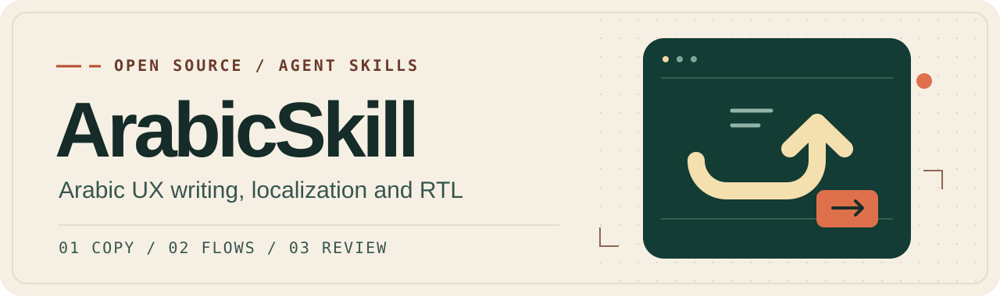
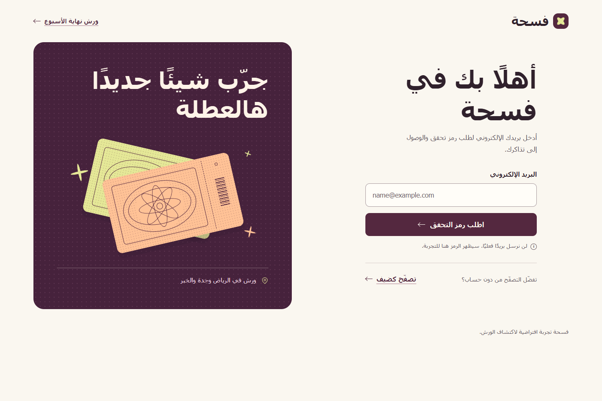
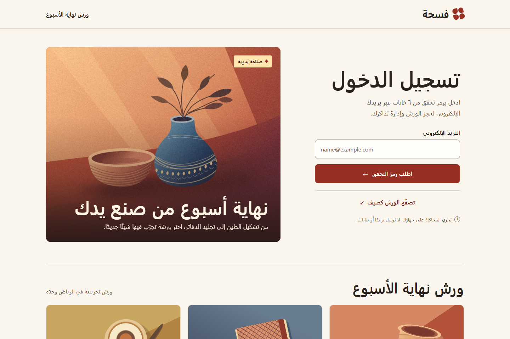

# ArabicSkill



**اكتب واجهات عربية تبدأ من حاجة المستخدم، لا من ترجمة النص الإنجليزي.**

مهارة مفتوحة المصدر لوكلاء الذكاء الاصطناعي. تساعدك على كتابة الأزرار والنماذج والتنبيهات، وتوطين المنتجات، واختيار مسار واجهة يناسب جمهورك.

[التثبيت](#ابدأ-في-دقيقة) · [أمثلة قبل وبعد](#الفرق-في-النتيجة) · [الإصدارات](https://github.com/theonlym7md/arabic-ai-skills/releases) · [skills.sh](https://skills.sh/theonlym7md/arabic-ai-skills/arabicskill) · [English guide](docs/GETTING_STARTED.en.md)

[](https://github.com/theonlym7md/arabic-ai-skills/actions/workflows/ci.yml) · [ترخيص MIT](LICENSE)

## ابدأ في دقيقة

```bash
npx skills add theonlym7md/arabic-ai-skills --skill arabicskill
```

بعد التثبيت جرّب هذا الطلب:

> استخدم $arabicskill لكتابة عنوان ووصف وزر لدفع لم تتضح نتيجته. لا نعرف هل خُصم المبلغ، لكن يوجد إجراء للتحقق من حالة العملية. اكتب بفصحى واضحة.

| المهارة | متى تختارها؟ |
| --- | --- |
| [arabicskill](https://skills.sh/theonlym7md/arabic-ai-skills/arabicskill) | عندما تحتاج كتابة نصوص منتج، أو تدقيقها، أو تكييف اللهجة، أو توطين ملفات JSON/ICU للعربية |
| [arabic-uiux-master](https://skills.sh/theonlym7md/arabic-ai-skills/arabic-uiux-master) | عندما تريد تصميم أو مراجعة شاشة عربية كاملة تجمع هندسة RTL والطباعة العربية وإتاحة الوصول (WCAG 2.2) |

لتثبيت المهارة المرافقة:

```bash
npx skills add theonlym7md/arabic-ai-skills --skill arabic-uiux-master
```

اسم المشروع **ArabicSkill** ومعرّف التثبيت **arabicskill**. إذا كنت تستخدم `arabic-intelligence` سابقًا، ابدأ من [دليل الانتقال](docs/MIGRATION.md).

## الفرق في النتيجة

### نفس البرومبت: ابنِ صفحة تسجيل دخول

> ابنِ صفحة تسجيل دخول عربية كاملة لمنتج سعودي افتراضي اسمه فسحة، لاكتشاف ورش نهاية الأسبوع وحجزها. المستخدم يدخل ببريده الإلكتروني للحصول على رمز تحقق ثم إدارة تذاكره، ومن لا يريد تسجيل الدخول يستطيع تصفّح الورش كضيف. اجعلها صفحة RTL تعمل على الجوال وسطح المكتب، وتعامل مع البريد غير الصالح وحالة طلب الرمز في المحاكاة. اختر بنفسك التخطيط والألوان والخطوط والنص والرسوم، وسلّم HTML وCSS وJavaScript في ملف واحد يعمل محليًا دون مكتبات أو أصول خارجية، ودون إرسال بريد أو بيانات فعليًا. وضّح حالة المحاكاة عند الطلب، واربط إجراء الضيف بمحتوى تجريبي داخل نفس الصفحة.

جلستان مستقلتان، وصفحتان كاملتان من الصفر. لم نشارك القالب أو الألوان أو النصوص؛ ثبّتنا طلب المنتج ومقاس التصوير فقط.

#### قبل · بدون مهارة



[لقطة الجوال](https://github.com/theonlym7md/arabic-ai-skills/blob/main/docs/demos/login-build/baseline-mobile.png) · [مصدر الصفحة](https://github.com/theonlym7md/arabic-ai-skills/blob/main/docs/demos/login-build/baseline/index.html)

#### بعد · مع ArabicSkill 2.2.0 فقط



[لقطة الجوال](https://github.com/theonlym7md/arabic-ai-skills/blob/main/docs/demos/login-build/arabicskill-mobile.png) · [مصدر الصفحة](https://github.com/theonlym7md/arabic-ai-skills/blob/main/docs/demos/login-build/arabicskill/index.html)

في هذه الجولة، خرجت النسخة الأولى بهوية بنفسجية ورسوم تذاكر، بينما اختارت ArabicSkill ألوان الطين ونفّذت معرض ورش ظاهرًا من البداية. النسختان تشتركان في الدخول بالبريد، لكن نسخة ArabicSkill تربط اختيار ورشة بمسار دخول ينتهي بحجز تجريبي؛ النسخة الأولى تنتهي بعرض التذاكر.

[طريقة المقارنة وإعادة التصوير](https://github.com/theonlym7md/arabic-ai-skills/blob/main/docs/demos/login-build/README.md) · [مقارنة الشاشات الثلاث (A/B)](https://github.com/theonlym7md/arabic-ai-skills/blob/main/docs/demos/arabicskill-ab/README.md). هذه عينة واحدة لكل شرط؛ الاختلاف الملحوظ لا يثبت تفوقًا عامًا.

## ما الجديد في 2.3

- **توسيع المجالات وتصميم الصفحة:** مرجع مستقل لاختيار تكوين الشاشة حسب المهمة في المهارتين، وتغطية كاملة لبرمجيات الأعمال (B2B SaaS) والرعاية الصحية واسترداد الأخطاء والإشعارات وطيف النبرة، مع قواعد طباعة عربية وهندسة RTL/WCAG 2.2 متكاملة في `arabic-uiux-master`.
- **توحيد قاعدة المعرفة والتوجيه:** مصفوفة توجيه واحدة (`routing.yaml`) وملف أوزان وحيد (`weights.yaml`) ومراحل تفكير متسلسلة (`1`–`3`)، مع عزل صريح لكيانات السعودية عبر `region_scope` لمنع تسرّبها إلى بقية الدول العربية.
- **عربية أوضح وانضباط ترقيم أدق:** منع النقطة الختامية والنقاط الزخرفية (`..` / `...` / `…`) في العناوين الرئيسية وعناوين الأقسام والبطاقات وتسميات الحقول والأزرار والشارات والتبويبات، وتصحيح مصطلحات التوطين واللهجات وإتاحة الوصول.
- **حزمة SDK معيارية وآمنة (CJS + ESM):** تقسيم `src/` إلى وحدات مستقلة، ودعم ESM أصيل، وتأمين `baseURL` ضد SSRF، وإلغاء عبر `AbortSignal`، ومعالجة دقيقة لرفض النموذج والأخطاء المهيكلة (`ArabicSkillError`)، وتقليص حجم البرومبت بالتحميل الانتقائي.

[اختيار تصميم الصفحة](skills/arabicskill/references/design-decisions.md) · [أنماط التجربة](skills/arabicskill/references/experience-patterns.md) · [أمثلة الواجهات](skills/arabicskill/references/ui-flows.md) · [مرجع RTL للشاشات](skills/arabic-uiux-master/references/flow-patterns.md)

<details>
<summary>كيف بُنيت الأمثلة، وما الذي تثبته الاختبارات؟</summary>

يوثّق سجل 23 نوفمبر 2026 الصفحات والأدلة العامة لـ81 مدخلًا بعد دمج التكرار، ودرجة الوصول لكل مرجع، والفحص البصري لعينة من الصفحات. تشرح قاعدة المعرفة كيف تستخدم المهارة نتائج المراجعة في اختيار تكوين الشاشة. [سجل المراجعة](https://github.com/theonlym7md/arabic-ai-skills/blob/main/docs/research/site-review-2026-11-23.md) · [سجل المصادر السابق](skills/arabicskill/references/saudi-sources.md)

يتضمن المشروع **٢٥ حالة تقييم مرجعية**. الفحوص الآلية تتحقق من ملفاتها وبنية المخرجات والروابط والعقود البرمجية. لا تثبت تحسّن جودة نموذج حي أو امتثال واجهة فعلية. راجع [منهجية التقييم](benchmarks/README.md) و[مسار العمل](docs/WORKFLOW.md).

</details>

## للمطوّرين

التكامل البرمجي اختياري (يدعم CommonJS وESM). يتطلب Node.js 22 فأحدث، ومفتاح OpenAI للطلبات الحية فقط.

```bash
npm ci
npm run check
npm run benchmark
node examples/sdk.cjs
```

[مثال التكامل](examples/sdk.cjs) · [حدود التنفيذ](SPEC.md) · [دليل التوافق](docs/COMPATIBILITY.md)

يرسل التكامل سياق المنتج إلى OpenAI وقد تترتب تكلفة؛ لا ترسل بيانات حساسة. استخدام `store: false` افتراضيًا ليس ضمانًا شاملًا لعدم الاحتفاظ بالبيانات لدى المزود.

## العرض والمساهمة

[شاهد العرض التوضيحي — ٥٤ ثانية](https://github.com/theonlym7md/arabic-ai-skills/blob/main/docs/assets/arabic-ai-skills-demo.mp4). يحمل الفيديو هوية ArabicSkill الحالية بتصميم داكن مع أمثلة تحريرية مبكرة (قبل إضافات 2.3).

وجدت صياغة مربكة أو حالة لا تغطيها المهارة؟ شارك مثالًا بعد إزالة البيانات الشخصية، مع السياق والصياغة المتوقعة.

[المساهمة](CONTRIBUTING.md) · [الإبلاغ عن مشكلة](https://github.com/theonlym7md/arabic-ai-skills/issues) · [النقاشات](https://github.com/theonlym7md/arabic-ai-skills/discussions) · [الأمان](SECURITY.md) · [سجل التغييرات](CHANGELOG.md) · [خارطة الطريق](ROADMAP.md)
