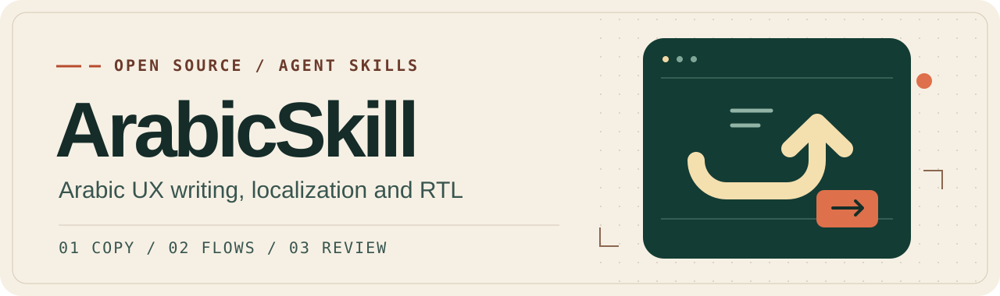
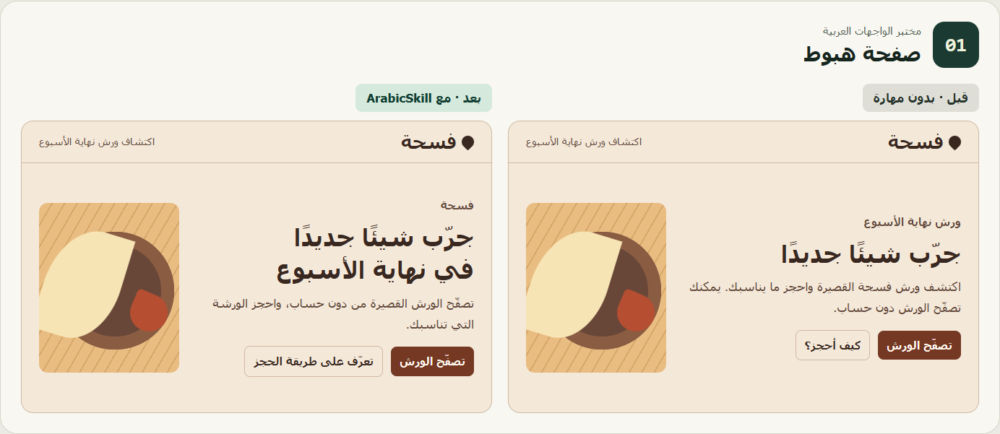
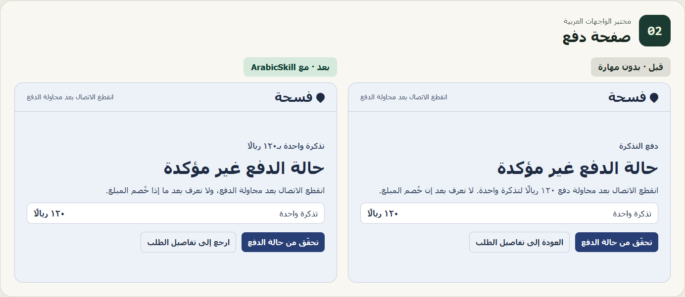
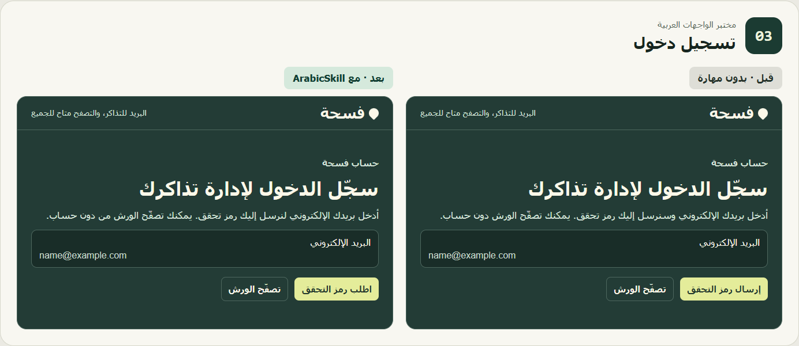

# ArabicSkill



**اكتب واجهات عربية تبدأ من حاجة المستخدم، لا من ترجمة النص الإنجليزي.**

مهارة مفتوحة المصدر لوكلاء الذكاء الاصطناعي. تساعدك على كتابة الأزرار والنماذج والتنبيهات، وتوطين المنتجات، واختيار مسار واجهة يناسب جمهورك.

[التثبيت](#ابدأ-في-دقيقة) · [أمثلة قبل وبعد](#الفرق-في-النتيجة) · [الإصدارات](https://github.com/theonlym7md/arabic-ai-skills/releases) · [skills.sh](https://skills.sh/theonlym7md/arabic-ai-skills/arabicskill) · [English guide](docs/GETTING_STARTED.en.md)

[](https://github.com/theonlym7md/arabic-ai-skills/actions/workflows/ci.yml) · [ترخيص MIT](LICENSE)

## ابدأ في دقيقة

```bash
npx skills add theonlym7md/arabic-ai-skills --skill arabicskill
```

بعد التثبيت جرّب هذا الطلب:

> استخدم $arabicskill لكتابة عنوان ووصف وزر لدفع لم تتضح نتيجته. لا نعرف هل خُصم المبلغ، لكن يوجد إجراء للتحقق من حالة العملية. اكتب بفصحى واضحة.

| المهارة | متى تختارها؟ |
| --- | --- |
| [arabicskill](https://skills.sh/theonlym7md/arabic-ai-skills/arabicskill) | عندما تحتاج كتابة نصوص منتج، أو تدقيقها، أو توطين رسائل ومنتجات رقمية للعربية |
| [arabic-uiux-master](https://skills.sh/theonlym7md/arabic-ai-skills/arabic-uiux-master) | عندما تريد مراجعة شاشة أو رحلة كاملة تجمع النص واتجاه RTL وإتاحة الاستخدام |

لتثبيت المهارة المرافقة:

```bash
npx skills add theonlym7md/arabic-ai-skills --skill arabic-uiux-master
```

اسم المشروع **ArabicSkill** ومعرّف التثبيت **arabicskill**. إذا كنت تستخدم `arabic-intelligence` سابقًا، ابدأ من [دليل الانتقال](docs/MIGRATION.md).

## الفرق في النتيجة

ثلاث شاشات لمنتج افتراضي اسمه **فسحة**. في كل صورة: **بدون مهارة على اليمين، ومع ArabicSkill 2.2.0 فقط على اليسار**. استخدمت الجلستان الطلب نفسه، وعُرضت النصوص الأصلية بنفس تصميم الشاشة ومقاسها.

### ١ · صفحة هبوط



نقلت نسخة ArabicSkill «نهاية الأسبوع» إلى العنوان نفسه، وسمّت وجهة الإجراء الثانوي «تعرّف على طريقة الحجز». النسخة الأخرى أبقت موعد الورش في التمهيد واستخدمت «كيف أحجز؟».

### ٢ · حالة دفع غير مؤكدة



النسختان وضّحتا عدم اليقين وقدّمتا التحقق بدل إعادة الدفع. فصلت نسخة ArabicSkill قيمة التذكرة عن شرح الانقطاع وكتبت زر الرجوع بفعل مباشر.

### ٣ · تسجيل الدخول بالبريد



النسختان ربطتا تسجيل الدخول بإدارة التذاكر وأبقتا التصفح متاحًا دون حساب. الفرق الأوضح هو «اطلب رمز التحقق» مقابل «إرسال رمز التحقق».

[الطلب وطريقة إعادة إنتاج اللقطات](docs/demos/arabicskill-ab/README.md) · [النصوص الأصلية](docs/demos/arabicskill-ab/copy.js)

هذه مقارنة توضيحية بجولة واحدة لكل شرط، لا اختبارًا إحصائيًا أو ادعاء تفوق. الواجهات ثابتة؛ لا ترسل رمز تحقق ولا تنفّذ دفعًا.

## ما الجديد في 2.2

- **تصميم المسار، لا النص وحده:** ستة أنماط للمصادقة، وستة للدفع والسلة والتسعير، مع إرشادات للحجز وتوجيه الاستمارات حسب هدف المستخدم.
- **رسائل أكثر تحديدًا:** تدفقات للرموز المؤقتة والتحقق داخل النماذج، ورسائل تفرّق بين نتيجة مؤكدة ونتيجة غير مؤكدة في واجهات الذكاء الاصطناعي.
- **عربية أوضح داخل الواجهة:** لا نقطة ختامية في العناوين والأزرار والشارات. التوطين يحافظ على المتغيرات والمفاتيح وصيغ الجمع، وإرشادات RTL تفرّق بين الحقول الرقمية والحقول التي تقبل الحروف والأرقام.
- **تكامل برمجي ينتقي الإرشادات بحسب الطلب:** يدعم تحديد المنطقة واللهجة، ويستبعد الخيارات الطويلة أو التي تخالف قاعدة النقطة في العناوين والأزرار والشارات المعروفة.

[أنماط التجربة](skills/arabicskill/references/experience-patterns.md) · [أمثلة الواجهات](skills/arabicskill/references/ui-flows.md) · [مرجع RTL للشاشات](skills/arabic-uiux-master/references/flow-patterns.md)

<details>
<summary>كيف بُنيت الأمثلة، وما الذي تثبته الاختبارات؟</summary>

يوثّق [سجل المصادر](skills/arabicskill/references/saudi-sources.md) مراجعة واجهات عامة من قائمة بدأت بـ١١٥ رابطًا، وحدود الوصول لبعض المواقع. استُخلصت منها أنماط للتكييف، دون نسخ أسعار أو شروط أو شعارات. هذا تطوير لتعليمات المهارة، وليس تدريبًا للنموذج أو اعتمادًا من العلامات المذكورة.

يتضمن المشروع **٢١ حالة تقييم مرجعية**. الفحوص الآلية تتحقق من ملفاتها وبنية المخرجات والروابط والعقود البرمجية. لا تثبت تحسّن جودة نموذج حي أو امتثال واجهة فعلية. راجع [منهجية التقييم](benchmarks/README.md) و[مسار العمل](docs/WORKFLOW.md).

</details>

## للمطوّرين

التكامل البرمجي اختياري. يتطلب Node.js 22 أو 24، ومفتاح OpenAI للطلبات الحية فقط.

```bash
npm ci
npm run check
npm run build
node examples/sdk.cjs
```

[مثال التكامل](examples/sdk.cjs) · [حدود التنفيذ](SPEC.md) · [دليل التوافق](docs/COMPATIBILITY.md)

يرسل التكامل سياق المنتج إلى OpenAI وقد تترتب تكلفة؛ لا ترسل بيانات حساسة. استخدام `store: false` افتراضيًا ليس ضمانًا شاملًا لعدم الاحتفاظ بالبيانات لدى المزود.

## العرض والمساهمة

[شاهد العرض التوضيحي السابق — ٥٤ ثانية](https://github.com/theonlym7md/arabic-ai-skills/blob/main/docs/assets/arabic-ai-skills-demo.mp4). الفيديو يحمل الهوية السابقة ويعرض أمثلة تحريرية، ولا يشرح جميع إضافات 2.2.

وجدت صياغة مربكة أو حالة لا تغطيها المهارة؟ شارك مثالًا بعد إزالة البيانات الشخصية، مع السياق والصياغة المتوقعة.

[المساهمة](CONTRIBUTING.md) · [الإبلاغ عن مشكلة](https://github.com/theonlym7md/arabic-ai-skills/issues) · [النقاشات](https://github.com/theonlym7md/arabic-ai-skills/discussions) · [الأمان](SECURITY.md) · [سجل التغييرات](CHANGELOG.md) · [خارطة الطريق](ROADMAP.md)
