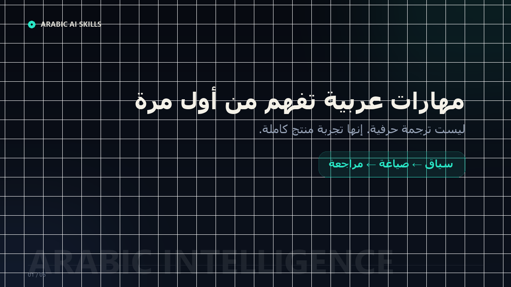
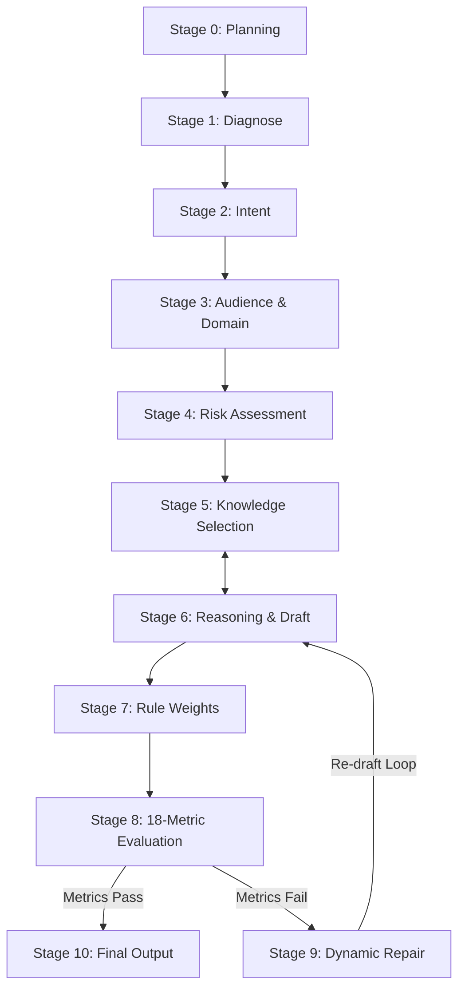

# Arabic AI Skills

Production-focused skills for natural Arabic UX writing, RTL interfaces, product localization,
and Arabic copy review across Codex, Claude Code, Cursor, and other AI agents.

مهارات مفتوحة المصدر لكتابة واجهات عربية طبيعية، ومراجعة تجربة RTL، وتوطين نصوص المنتجات.

[](https://github.com/theonlym7md/arabic-ai-skills/releases/tag/v1.2.1)
[](LICENSE)
[](https://github.com/theonlym7md/arabic-ai-skills/actions/workflows/ci.yml)
[](https://github.com/theonlym7md/arabic-ai-skills/actions/workflows/codeql.yml)
[](https://skills.sh/theonlym7md/arabic-ai-skills)

---

## 📌 Versioning Alignment
`Framework Spec: v1.2.0-STABLE | Skill Package: v1.2.1 | API Compatibility: 1.x`

---

## ❓ What is this?
Arabic Intelligence is a guided 11-stage workflow (stages 0–10) for generating natural, culturally localized Arabic UX microcopy, product copy, and interface messaging.

## 💡 Why does it exist?
Standard LLMs struggle with Arabic product copy—defaulting to literal English translations, robotic administrative clichés (*"في إطار حرصنا المستمر"*, *"يرجى التكرم بالعلم"*), and high cognitive load. Arabic Intelligence eliminates AI slop via ontological rule graphs, anti-example cliché bans, and an 18-metric rubric.

## 👤 Who is it for?
- **AI Agent Engineers & Prompt Designers:** Adding Arabic product copywriting capabilities to agents.
- **Product Managers & UX Writers:** Standardizing localized Arabic UX copy across platforms.
- **GovTech, FinTech & E-Commerce Teams:** Enforcing authentic regional phrasing (Saudi & Gulf).

---

## 🎬 See the Difference

[](https://github.com/theonlym7md/arabic-ai-skills/blob/main/docs/assets/arabic-ai-skills-demo.mp4)

**[▶ Watch the full 54-second HD demo](https://github.com/theonlym7md/arabic-ai-skills/blob/main/docs/assets/arabic-ai-skills-demo.mp4)** — three before/after transformations covering GovTech empty states, payment errors, and location-permission prompts.

---

## ⚡ Quick Example

### ❌ Raw AI Output (Robotic Cliché Slop)
> *"في إطار حرصنا المستمر على تقديم أفضل الخدمات، يرجى التكرم بالعلم بأنه لا يوجد لديكم أي مخالفات مرورية حالياً."*

### ✅ Arabic Intelligence Output
> **العنوان:** "لا توجد مخالفات مسجّلة عليك"
> **الوصف:** "لا توجد أي مخالفات مرورية مسجلة بحقك حالياً. نتمنى لك قيادة آمنة."

---

## 🚀 Quick Install

Choose the focused writing framework or the combined UI/RTL skill:

```bash
npx skills add theonlym7md/arabic-ai-skills --skill arabic-intelligence
npx skills add theonlym7md/arabic-ai-skills --skill arabic-uiux-master
```

Browse the published collection on **[skills.sh](https://skills.sh/theonlym7md/arabic-ai-skills)** or open the individual Agent Skills listings: **[arabic-intelligence](https://www.agentskills.in/marketplace/%40theonlym7md/arabic-intelligence)** · **[arabic-uiux-master](https://www.agentskills.in/marketplace/%40theonlym7md/arabic-uiux-master)**.

| Skill | Best for |
| :--- | :--- |
| [`arabic-intelligence`](skills/arabic-intelligence/README.md) | Arabic product copy, localization, terminology, and copy audits |
| [`arabic-uiux-master`](skills/arabic-uiux-master/README.md) | Arabic interface copy combined with RTL, typography, and accessibility guidance |

### Optional local Node.js SDK

The repository includes an SDK for contributors and local integrations. It requires Node.js 22
or 24 LTS and an `OPENAI_API_KEY` environment variable.

```bash
git clone https://github.com/theonlym7md/arabic-ai-skills.git
cd arabic-ai-skills
npm ci
npm run build
```

```javascript
const { generateArabicCopy } = require("./dist/index.js");

async function main() {
  const result = await generateArabicCopy({
    projectNiche: "GovTech",
    targetAudience: "Saudi residents",
    toneOfVoice: "Official and clear",
    textType: "Empty state",
    context: "Traffic violation page with no recorded violations",
  });

  console.log(result.options);
}

main().catch(console.error);
```

The SDK reads `OPENAI_API_KEY` from the environment by default. Set `OPENAI_MODEL` or pass `model` to choose a model explicitly.
The same example is available as [`examples/sdk.cjs`](examples/sdk.cjs).

---

## 🧠 Architecture Topology



---

## ⚖️ Capability Matrix

| Category | Status | Capabilities & Directives |
| :--- | :---: | :--- |
| **GovTech & Official** | `Production / Stable` | Saudi & Gulf GovTech tone, empty states, official notices |
| **FinTech & Payments** | `Production / Stable` | Payment friction removal, checkout retry, trust anchors |
| **SaaS & Landing Pages** | `Production / Stable` | Hero value propositions, CTAs, feature cards |
| **E-Commerce** | `Production / Stable` | Cart recovery, transactional alerts, product copy |
| **Media & Content** | `Production / Stable` | Podcasts, White Dialect Arabic, youth-focused copy |
| **Healthcare** | `Experimental` | Patient onboarding, appointment booking |
| **Legal Contracts** | `Unsupported` | *Not supported. Requires specialized legal counsel.* |
| **Medical Diagnostics** | `Unsupported` | *Not supported. Requires licensed medical evaluation.* |
| **Marketing Spam** | `Unsupported` | *Forbidden by framework ethical rules.* |

---

## 📂 Protocol Specifications & Developer Tools

- 📜 **Protocol Specification:** Read [SPEC.md](SPEC.md) for formal stage contracts, error codes, & runtime SDK specs.
- 📑 **Compatibility Spec:** Read [docs/COMPATIBILITY.md](docs/COMPATIBILITY.md).
- 📑 **CI Pipeline Specification:** Read [docs/CI_PIPELINE.md](docs/CI_PIPELINE.md).
- 📑 **Architecture Decision Records:** Read [ADR-001](docs/adr/ADR-001-why-working-memory.md), [ADR-002](docs/adr/ADR-002-why-ontology.md), and [ADR-003](docs/adr/ADR-003-why-plugins.md).
- 📊 **Benchmark Methodology:** Read [benchmarks/README.md](skills/arabic-intelligence/benchmarks/README.md) for rubric evaluation details.
- 🛠️ **Universal System Validator:** Run `node scripts/validate_all.js`.
- 📦 **Pristine Clean Packaging:** Run `node scripts/package_zip.js` to build a clean distribution zip (excluding `.git` & `node_modules`).
- 🤝 **Contributing:** Check our [CONTRIBUTING.md](CONTRIBUTING.md) guide before submitting PRs.
- 🔒 **Security:** Report vulnerabilities privately using [SECURITY.md](SECURITY.md).
- 🧭 **Roadmap:** See [ROADMAP.md](ROADMAP.md) for focused future work.
- 📝 **Releases:** Review user-visible changes in [CHANGELOG.md](CHANGELOG.md).

---

<div align="center">

**Stable 1.x framework specification. Changes are tested on Node.js 22 and 24 LTS.**

</div>
