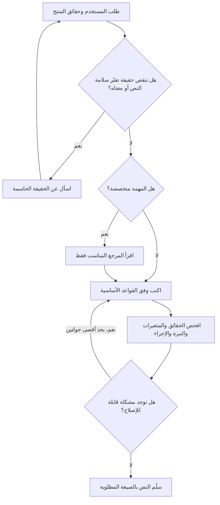

# مسار عمل مهارة ArabicSkill

هذا مخطط للتعليمات التي ينفذها الوكيل، وليس وصفًا لمحرك حالة برمجي.

عند غياب ملف مجال متخصص، استخدم القواعد العامة ولا تخترع مصدرًا أو نتيجة مراجعة. عند تشغيل المهارة عبر الوكيل، يُقرأ كل مرجع عند الحاجة فقط (الكشف التدريجي). أما حزمة SDK فتقرأ القواعد المصرّفة من [routing.yaml](../skills/arabicskill/knowledge/relations/routing.yaml) لتحميل الأقسام المطابقة فقط من [أنماط المجال](../skills/arabicskill/references/sector-patterns.md) و[تدفقات الواجهة](../skills/arabicskill/references/ui-flows.md) و[أنماط التجربة](../skills/arabicskill/references/experience-patterns.md) و[الحالات الحساسة](../skills/arabicskill/references/sensitive-states.md)، ولا تضمّن [دليل اللهجات](../skills/arabicskill/references/dialects.md) أو [التوطين](../skills/arabicskill/references/localization.md) إلا عند وجود إشارة واضحة في المدخلات، كما تزيل الكتل الموسومة بـ `<!-- agent-only -->` ولا تحمل `saudi-sources.md` أو `design-decisions.md`.

لكل مهارة ملف `agents/openai.yaml` داخل مجلدها؛ جذر المستودع ليس مهارة مستقلة. مراجعة صفحات عامة لا تعني اختبار رحلة تسجيل الدخول أو الحجز أو الدفع خلف بوابات الدخول، ولا تجعل شروطها ثابتة أو قابلة للنقل إلى منتج آخر.
