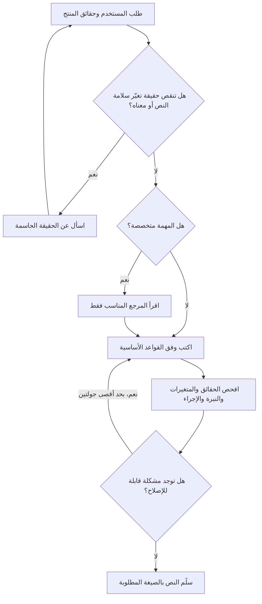

# مسار عمل مهارة ArabicSkill

هذا مخطط للتعليمات التي ينفذها الوكيل، وليس وصفًا لمحرك حالة برمجي.

عند غياب ملف مجال متخصص، استخدم القواعد العامة ولا تخترع مصدرًا أو نتيجة مراجعة. عند تشغيل المهارة عبر الوكيل، يُقرأ دليل اللهجات عند الحاجة؛ أما حزمة SDK فتضمّه في تعليماتها دائمًا، مع اشتراط عدم تطبيق لهجة إلا بطلب صريح أو سياق علامة مثبت. لكل مهارة ملف `agents/openai.yaml` داخل مجلدها؛ جذر المستودع ليس مهارة مستقلة.

تنطبق طريقة التحميل نفسها على [أنماط المجال](../skills/arabicskill/references/sector-patterns.md): الوكيل يقرأ القسم المطابق، وحزمة SDK تضم القواعد دون سجل المواقع. مراجعة صفحات عامة لا تعني اختبار رحلة تسجيل الدخول أو الحجز أو الدفع، ولا تجعل شروطها ثابتة أو قابلة للنقل إلى منتج آخر.
